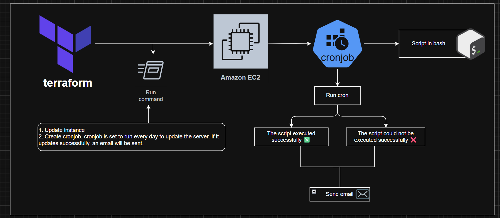

# Aws.Ec2.MonthlyUpdate.Cron.Terraform
This repository contains a collection of Bash scripts, managed with Terraform, that automate the creation of a cron job on an EC2 instance. The cron job runs automatically once a month and performs server update tasks to keep the system secure and up-to-date. After execution, the cron job sends an email to interested parties with a report of the update (the emailing part is delivered through an API, but it's not included in the script). This setup streamlines maintenance processes, minimizes manual intervention, and offers a reliable and easy way to ensure your server is up-to-date and secure. </br>
Run a script every first day of the month at 00:00 (0 0 1 * * root /bin/bash /usr/local/bin/initial-script.sh)

### Diagram


### 👣Steps with terraform
1. Terraform init and terraform workspace
```
terraform init
terraform workspace new qa
terraform workspace select qa
```

2. Terraform plan
```
terraform plan -var-file qa.tfvars
```
3. Terraform apply
```
terraform apply -var-file qa.tfvars
```
